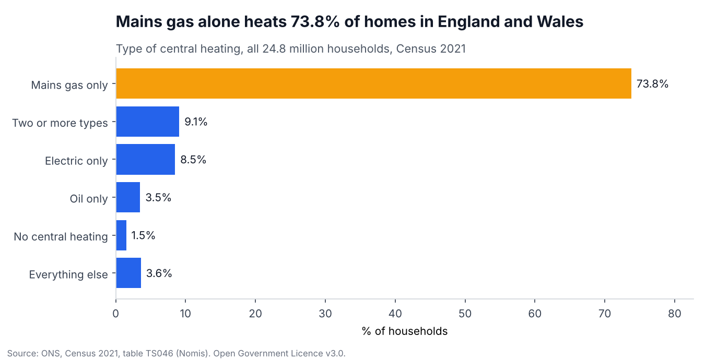
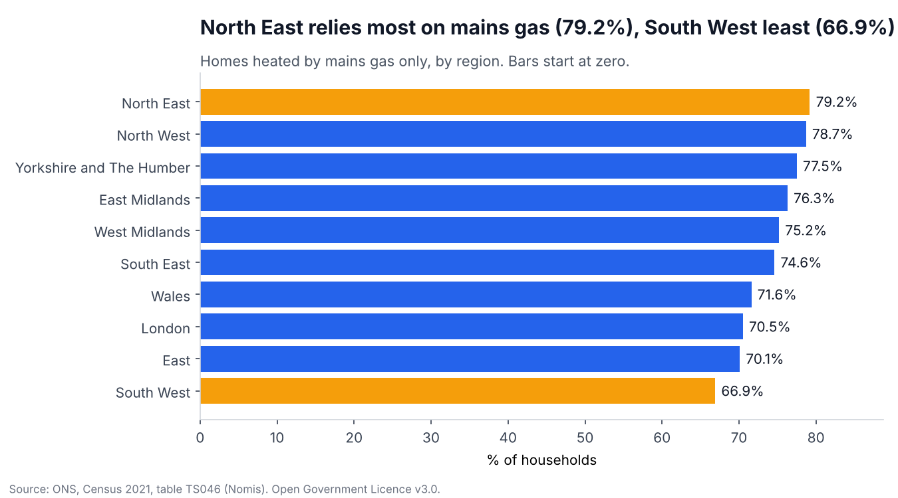
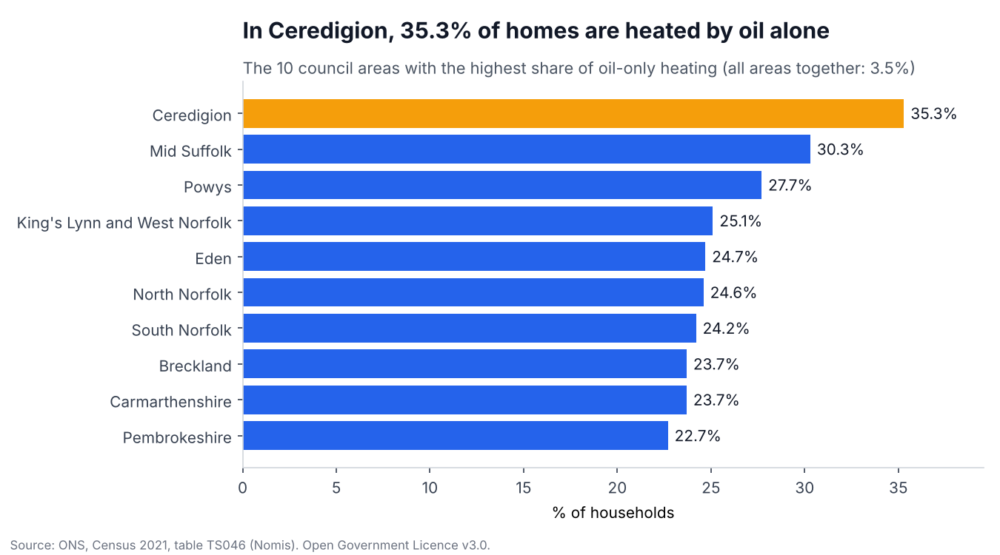

# How homes are heated: Census 2021

An analysis of **real, published data**: how 24.8 million households in England and Wales heat their homes, by council area.

Everything else in this repo uses made-up data. This one uses official figures, so anyone can check my numbers against the source.

## The data

| | |
|---|---|
| Source | Office for National Statistics, Census 2021, table **TS046 Central heating** |
| Downloaded from | [Nomis](https://www.nomisweb.co.uk/datasets/c2021ts046), the ONS service for census data, on 10 November 2026 |
| Covers | 331 local authority districts and 10 regions (9 English regions plus Wales), census day 21 March 2021 |
| Licence | Contains public sector information licensed under the [Open Government Licence v3.0](https://www.nationalarchives.gov.uk/doc/open-government-licence/version/3/) |
| Personal data | None. These are counts of households per area, already published by ONS |

`get_data.py` holds the exact download address and reshapes the download to one row per area. The two files it makes are in [data/](data/).

## Checks before any analysis

| Check | Result |
|---|---|
| Rows | 331 council areas and 10 regions, no duplicates |
| Does every area add up? | Yes. In all 341 rows the 12 heating types sum exactly to the area's total |
| Do the two levels agree? | Nearly. The 331 areas sum to 24,783,217 households. The 10 regions sum to 24,783,187. That is 30 apart, or 0.0001% |
| Does it match what ONS published? | Yes. ONS reports 1.5% (367,000) of households with no central heating. I get 1.5% (367,119) |

**About that gap of 30.** I expected the two totals to match and they don't. ONS changes small counts slightly in census tables to protect people's privacy, so totals built from different geographies can differ by a few. I believe that is the cause, but I have not proved it, so I've left the gap in plain sight instead of hiding it. It is far too small to change any answer here.

## The questions, answered in SQL

Each question is one query in [queries.sql](queries.sql). [answers.md](answers.md) has every query next to its result.

| Question | What the data says |
|---|---|
| 1. How are homes heated? | Mains gas alone heats 73.8% of homes. Electric only is 8.5%, oil only 3.5%, and 1.5% have no central heating. |
| 2. Which regions rely most on mains gas? | North East (79.2%) and North West (78.7%). The South West is lowest (66.9%). |
| 3. Where is oil heating most common? | Rural areas. Ceredigion is highest at 35.3%, ten times the overall 3.5%. Four of the top ten are in Wales and four are in Norfolk. |
| 4. Where do most homes have no central heating? | Isles of Scilly (17.5%, but only 942 households), then Westminster (3.9%) and City of London (3.7%). |
| 5. England or Wales? | England 74.0% mains gas only, Wales 71.6%. |
| 6. How different are council areas? | Very. Mains gas only ranges from 6.4% to 85.8%, and in 17 of 331 areas it heats fewer than half of homes. |







## What I'm careful not to claim

- **This is 2021.** Census day was 21 March 2021. Heating has changed since, so this is a snapshot, not today.
- **"Mains gas only" is not "has a gas boiler".** Another 9.1% of homes use two or more types of heating, and many of those include mains gas. So 73.8% is a floor for gas use, not the full figure.
- **Small places swing wildly.** The Isles of Scilly top one table with 942 households. A percentage from a tiny area should not be read like one from a city.
- **London's lower gas figure is not a rural effect.** London has the most electric-only and communal heating, which fits a city with many flats. The data shows the pattern. It does not prove the reason.
- **Census day was during a lockdown.** ONS notes some people were not living at their usual address. I have not adjusted for that.

## How it's checked

`test_heating.py` has 14 tests:

- every SQL answer is worked out a second way in plain Python, and the two must match
- nothing is lost loading into SQLite (341 areas in, 341 out)
- every chart title is tested, so a title can't stay up if the data stops supporting it
- the download reshaping is tested on a small sample

## Run it yourself

```
python heating.py       # checks the data, writes answers.md
python make_charts.py   # draws the three charts
pytest -q               # 14 tests
```

Only the Python standard library is needed, plus matplotlib for the charts and pytest for the tests.
