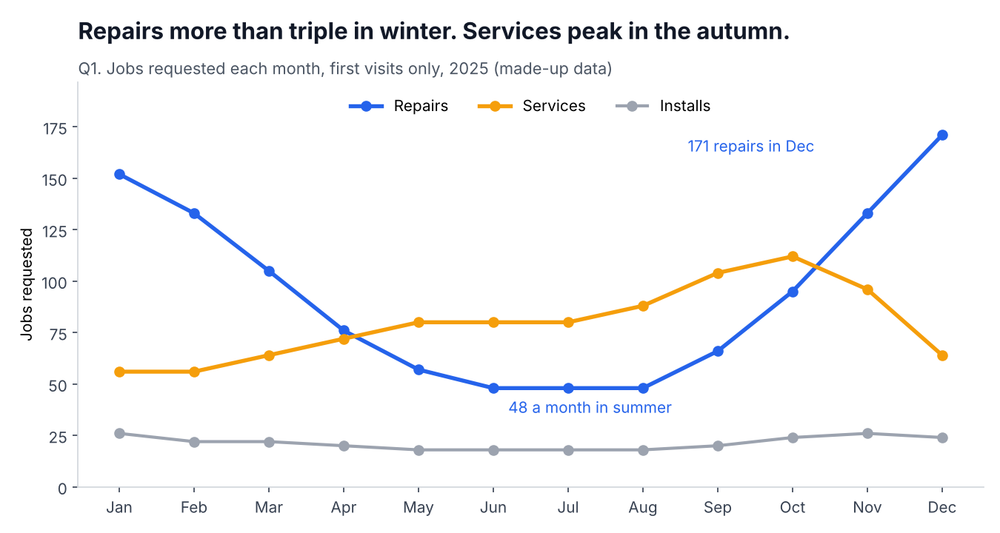
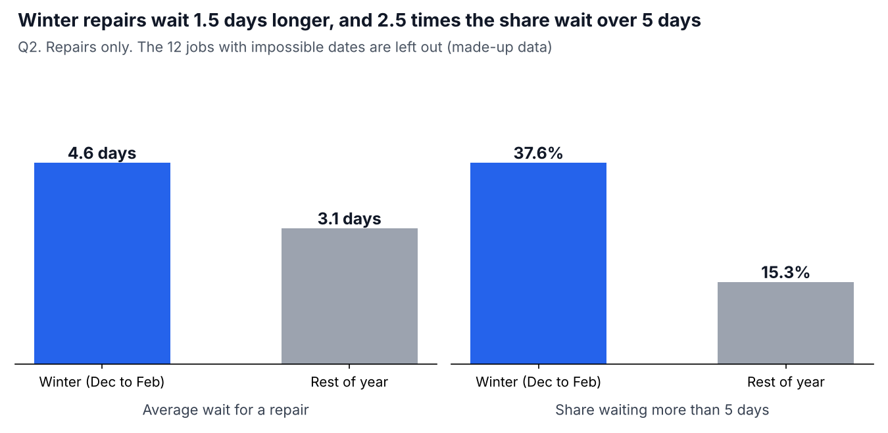
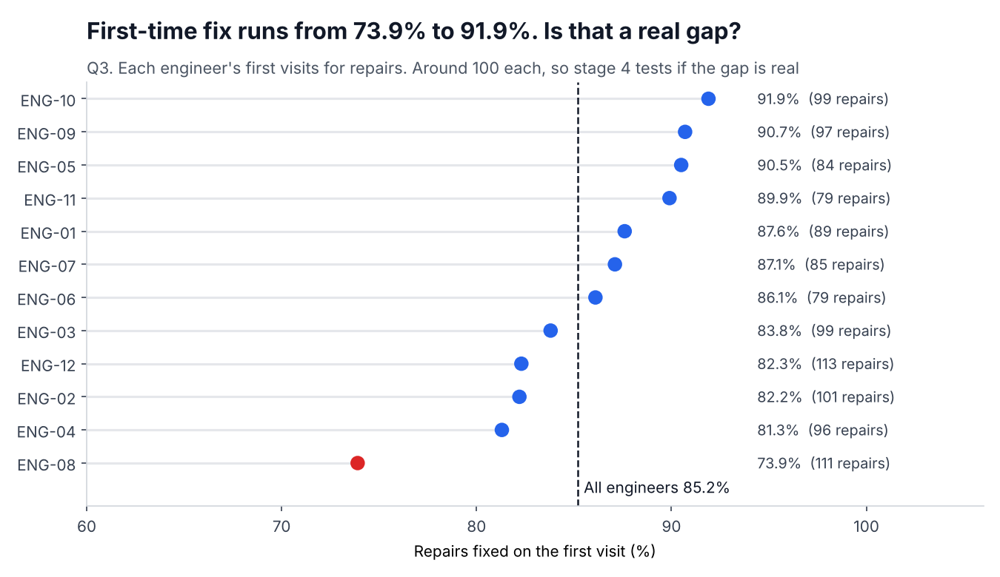
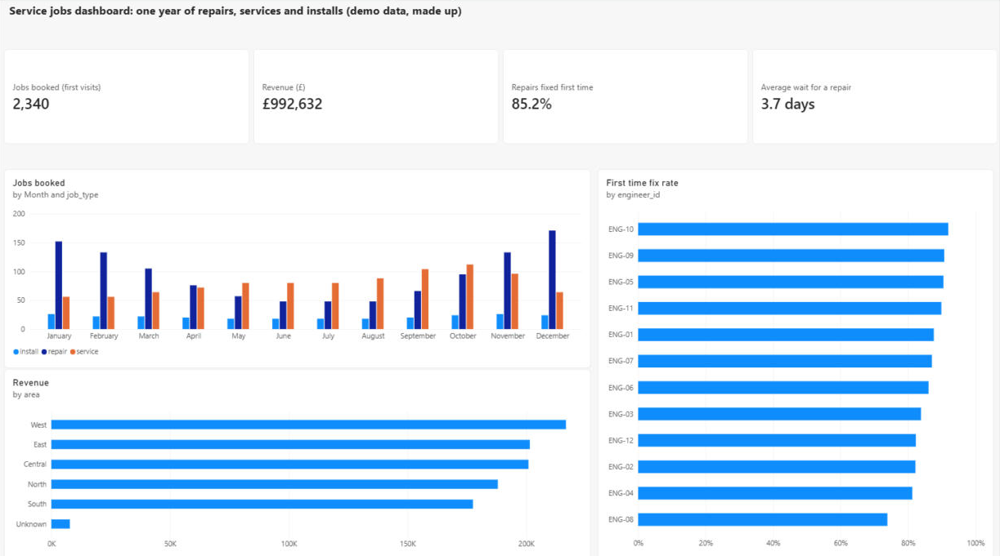

# Service jobs analysis: a data journey

A start-to-finish data analysis, done in 4 stages and shared as I go: clean, ask, chart, conclude.
The data is **completely made up** (see `make_data.py`). It copies the shape of a home service company's job export: repairs, services and installs over one year.

## The stages

| Stage | What I do | Status |
|---|---|---|
| 1 | [Get and clean the data](stage1-clean/) | Done |
| 2 | [Ask the business questions in SQL](stage2-sql/) | Done |
| 3 | [Turn the answers into charts](stage3-charts/) | Done |
| 4 | [What I found](stage4-findings/) | Done |

## Stage 1: get and clean the data

A raw export is never ready to use. This one has the mess a real one has, put there on purpose:

- the same job exported twice
- a test job left in
- dates in two formats (`2025-01-31` and `31/01/2025`)
- prices typed as text with a £ sign
- blank areas
- visits dated *before* the customer asked for them

`clean.py` fixes these and counts the rows before and after every step. The [cleaning log](stage1-clean/cleaning_log.md) has the full numbers:

| Step | Rows before | Rows after | Removed |
|---|---|---|---|
| Remove test jobs | 2,533 | 2,532 | 1 |
| Remove duplicate jobs | 2,532 | 2,507 | 25 |
| Fix formats | 2,507 | 2,507 | 0 |

**2,533 raw rows, 26 removed, 2,507 clean rows.** The numbers add up, and a test checks they always do.

### Decisions I made, and why

- **Duplicates:** when a job appears twice, keep the most complete copy rather than the first one.
- **Blank areas:** set to `Unknown`, not deleted. The job still happened and still counts.
- **Visit before request:** these 12 jobs are kept, but their waiting time is left blank, so they can't drag the waiting-time answers in stage 2.
- **Unknown date formats:** stop with an error instead of guessing. A wrong date is worse than no date.

## Stage 2: ask the business questions in SQL

The clean data goes into SQLite, and each question is one query in [queries.sql](stage2-sql/queries.sql). [answers.md](stage2-sql/answers.md) has every query next to its result. The short version:

| Question | What the SQL says |
|---|---|
| 1. Which months are busiest? | December (259 jobs) and November (255). June and July are quietest (146 each). Repairs drive it: 171 in December against 48 in summer. Services peak in October (112). |
| 2. Does winter mean longer waits for a repair? | Yes. 4.6 days on average in winter against 3.1 the rest of the year, and 37.6% wait more than 5 days against 15.3%. |
| 3. How many repairs are fixed first time? | Between 73.9% and 91.9% depending on the engineer. |
| 4. How often is a second visit needed? | 167 return visits for 1,132 repairs, so 14.8% more trips than jobs. |
| 5. Which area brings in the most? | West (£216,747), but it also has the most jobs. Per job, the five named areas are close (£406 to £436). |

### How I checked the SQL

A query can run without errors and still be wrong. So `test_stage2.py` answers every question a second way, in plain Python, and the two must match. It also checks that no rows went missing when loading into SQLite. If 2,507 rows go in, 2,507 must come out.

### What I'm careful not to claim yet

- **Engineers:** around 100 repairs each is a small sample. A gap between 74% and 92% *might* be a real difference, or it might be luck. Stage 4 checks this before naming anyone as a problem.
- **Areas:** West earns most because it has the most jobs, not because each job is worth more.

## Stage 3: turn the answers into charts

Three rules for every chart:

- **The title says the answer.** You should get the point without studying the chart.
- **The numbers in the title are tested.** If the data changes and a title stops being true, a test fails.
- **No tricks with the axis.** Bars start at zero. For the engineer chart I used dots, because dots can honestly start at 60%, where bars would make small gaps look huge.







The third chart asks a question rather than answering one. Is ENG-08 at 73.9% really worse, or did they just have an unlucky year? That's stage 4.

## Stage 4: what I found

The [full findings are here](stage4-findings/). In short: winter is the pressure point, 14.8% of repairs need a second visit, and the areas earn about the same per job.

The best part is a twist. My test flagged one engineer as worse, but because I made the data I know it picked the **wrong** one. I re-ran the whole year 500 times to find out if the method was broken (it isn't: it finds the right engineer 82% of the time, and a wrong one 3% of the time). This year was just an unlucky draw. That's why a flag should start a conversation, never end one.

## Power BI dashboard

The same data as a one-page [Power BI dashboard](powerbi/), with the DAX measures and a check that every card matches the SQL.



## Run it

```
python3 make_data.py              # makes data/jobs_raw.csv
python3 stage1-clean/clean.py     # makes data/jobs_clean.csv and the log
python3 stage2-sql/run_queries.py # runs the SQL, writes answers.md
python3 stage3-charts/make_charts.py
python3 stage4-findings/check_engineers.py
pytest -q                         # 23 checks
```
