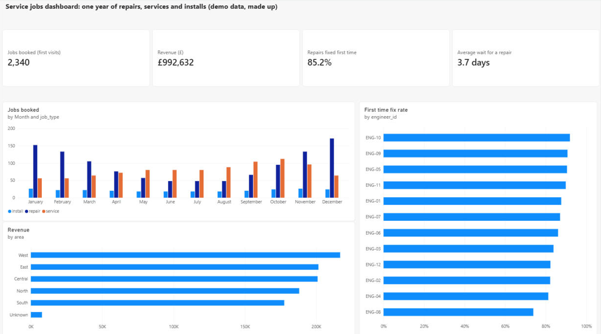

# Power BI dashboard: service jobs

The same made-up service jobs data as the rest of this analysis, built as a one-page dashboard in Power BI Desktop.

**Demo data, made up. No real company, customer or engineer is in it.**



## What it shows

| Card | Value | What it counts |
|---|---|---|
| Jobs booked (first visits) | 2,340 | First visits only, so a return visit isn't counted as a new job |
| Revenue (£) | £992,632 | Sum of the price column across all rows |
| Repairs fixed first time | 85.2% | Repairs fixed on the first visit, out of all first-visit repairs |
| Average wait for a repair | 3.7 days | Days from request to first visit, repairs only |

Below the cards: jobs booked by month and job type, first-time fix rate by engineer, and revenue by area.

## Where the data comes from

Power BI reads [`data/jobs_clean.csv`](../data/jobs_clean.csv) (2,507 rows), the cleaned file made in [stage 1](../stage1-clean/). Nothing is typed in by hand.

## The measures (DAX)

```dax
Jobs booked =
CALCULATE ( COUNTROWS ( jobs_clean ), jobs_clean[visit_type] = "first" )

Revenue = SUM ( jobs_clean[price_gbp] )

First time fix rate =
DIVIDE (
    CALCULATE (
        COUNTROWS ( jobs_clean ),
        jobs_clean[job_type] = "repair",
        jobs_clean[visit_type] = "first",
        jobs_clean[fixed_first_time] = "yes"
    ),
    CALCULATE (
        COUNTROWS ( jobs_clean ),
        jobs_clean[job_type] = "repair",
        jobs_clean[visit_type] = "first"
    )
)

Avg repair wait days =
CALCULATE (
    AVERAGE ( jobs_clean[wait_days] ),
    jobs_clean[job_type] = "repair",
    jobs_clean[visit_type] = "first"
)
```

## Checked against the SQL and Python

A dashboard is only useful if it agrees with the analysis behind it, so I checked each card against the figures from the earlier stages.

| Figure | Power BI | SQL / Python |
|---|---|---|
| First visits | 2,340 | 2,340 |
| Revenue | £992,632 | £992,632.43 |
| First-time fix rate | 85.2% | 85.2% |
| Average repair wait | 3.7 days | 3.67 days |
| Lowest engineer (ENG-08) | bottom bar | 73.9% in [stage 3](../stage3-charts/) |

## Limits

- This is a picture of the dashboard, not the live file. The `.pbix` file isn't in the repo.
- The "Unknown" bar in revenue by area is rows where the area was blank in the messy export. I left it visible instead of hiding it.
