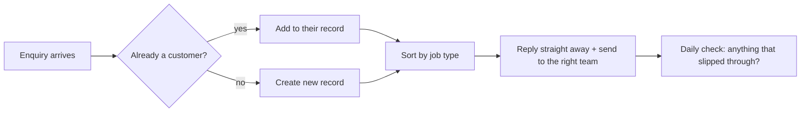

# Build #1: Enquiry auto-reply

**Status:** live · **Tools:** Zapier, Outlook, CRM, Google Sheets · **My part:** process design, rules, testing. AI helped write the code.

## The problem
Every customer enquiry needed someone to:
1. check if the person was already a customer,
2. copy their details across,
3. work out who should deal with it,
4. remember to reply.

Each step was a chance for the enquiry to sit there.

## What it does now

## Step 5, the one people skip
A daily check lists anything that came in but didn't get a reply or an owner. An automation isn't finished when it runs. It's finished when you can prove it didn't miss anything.

## How I tested it
Fake enquiries only, sent to my own inbox, before anything went live. Every live change has an undo.

## Impact
In its first 3 weeks live it answered about 570 enquiries, around 28 a day, without anyone typing a reply.

_No real customer data, company names or keys are in this write-up._
