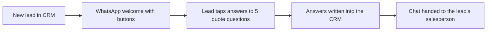

# Build #2: WhatsApp quote journey

**Status:** live · **Tools:** WhatsApp Business API, Cloudflare Workers, CRM API · **My part:** journey design (drawn as a flow first), rules, speed testing. AI helped write the code.

## The problem
New leads got a generic WhatsApp message, then waited for a salesperson to ask the same five quote questions by hand.

## What it does now

Safety rules: skip existing customers, skip anyone already booked in, one journey per phone number, "STOP" ends it.

## The speed fix
| | First reply |
|---|---|
| Before | about 2 min 40 s |
| After (testing) | 27 s |

The slow part wasn't the tech. It was a fixed 2-minute wait added "to be safe" while the CRM assigned a salesperson. I swapped it for a check every 5 seconds that moves on as soon as the owner is set.

**Lesson:** when something's slow, time each step before blaming the tool.

_No real customer data, company names or keys are in this write-up._
