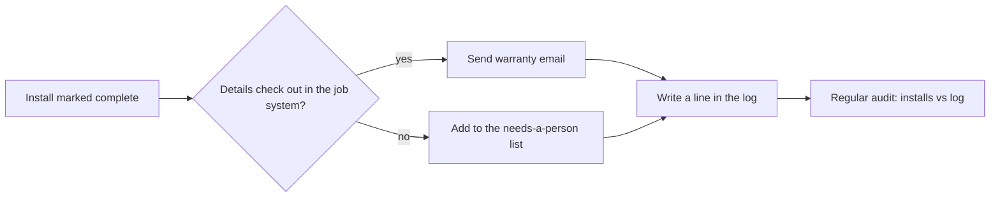

# Build #3: Automatic warranty emails

**Status:** live · **Tools:** email API, job system API, a spreadsheet log · **My part:** the rules, the checks, the "needs a person" list and the testing. AI helped write the code.

## The problem
After every install, someone had to remember to email the customer their warranty details. It's the kind of job that gets done on a quiet day and forgotten on a busy one.

## What it does now

## The part that matters
The send is the easy bit. The useful bits are either side of it:

- **Before:** a check against the job system. If the customer's details or the job don't line up, nothing is sent.
- **After:** every install ends up in one of two places, the sent log or the needs-a-person list. Nothing is allowed to vanish in between.
- **Audit:** I compare the list of installs with the log. If an install is in neither place, the automation has a hole.

## How I tested it
Fake customers and my own inbox first. Then a small batch with a person reading every email before the automation was trusted on its own.

**Lesson:** automate the boring send, but keep a list a human looks at for anything odd.

_No real customer data, company names or keys are in this write-up._
