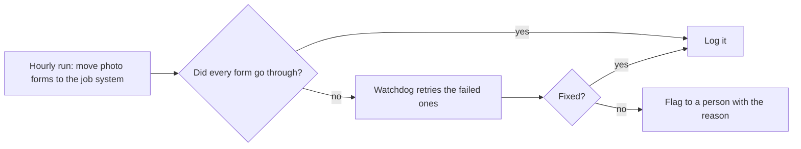

# Build #5: The automation that watches my automation

**Status:** live · **Tools:** form tool API, job system API, scheduled cloud tasks · **My part:** the process design, the failure rules and the testing. AI helped write the code.

## The problem
Engineers fill in a photo form after each job. An automation moves those photos into the job system every hour. One day a login expired. Nothing crashed and nobody got an error. The forms just quietly stopped moving, and a backlog built up before anyone noticed.

## What it does now

## The rules I set
- Every run writes down what it tried and what happened. No log line means the run didn't happen.
- A failed form is retried on its own. It is never skipped silently.
- If a retry still fails, a person gets told why: no matching job, login problem, or bad photo.
- When the login was fixed, the watchdog worked through the whole backlog in one go. Most went through automatically and the rest landed on the person list.

## How I tested it
I broke it on purpose. I pointed a test run at a form with no matching job and checked that it ended up on the person list with the right reason.

**Lesson:** automations fail quietly. If you build the automation, build the alarm too.

_No real customer data, company names or keys are in this write-up._
