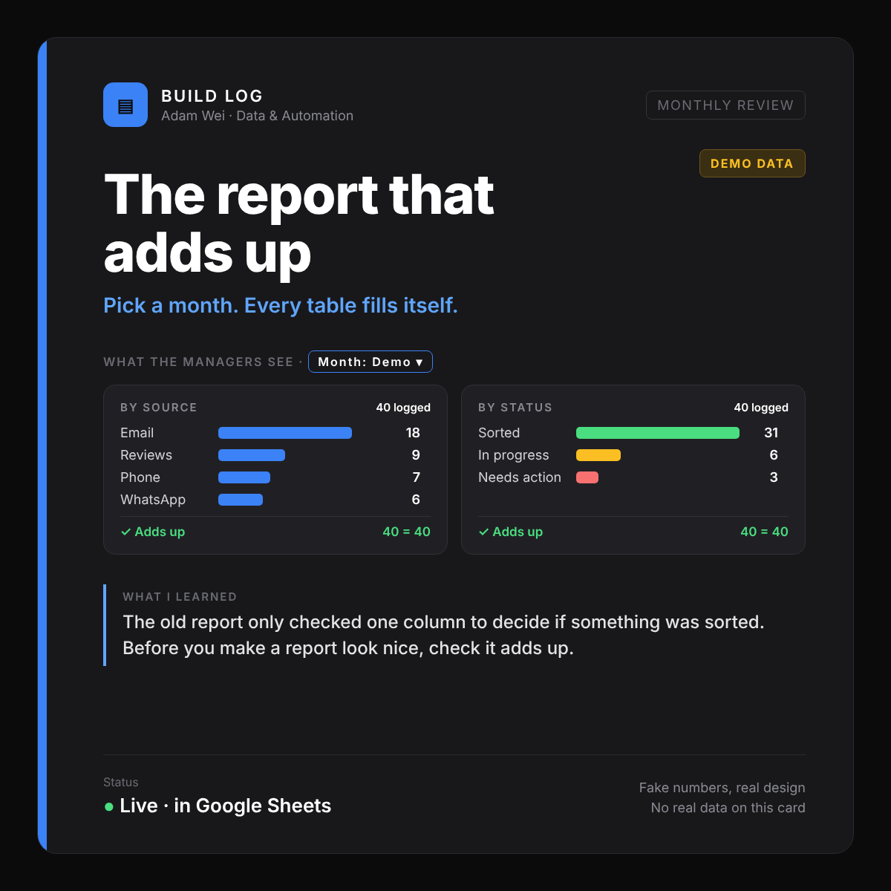
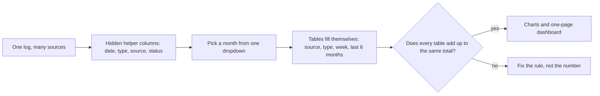

# Report: the monthly review that adds up

**Status:** live · **Tools:** Google Sheets (formulas, charts), a one-page dashboard · **My part:** finding what was wrong with the old report, the new layout, the checks. AI helped with the formulas.

_Every number in the picture is made up. It shows how the report works, not real results._

## The problem
Each month the managers review customer feedback from one big log. The summary was put together by hand, and the tables didn't agree with each other. The old version only looked at one column to decide if something was sorted, so it said almost nothing was.

## What it does now

## The rules I set
- One definition of "sorted", written down and used by every table.
- Every table must total to the same "logged" number. If one doesn't, something is being counted twice or missed.
- A backup of the old tab was kept, so the change could be undone.

**Lesson:** before you make a report look nice, check it adds up.

_No real customer data, company names or keys are in this write-up._
